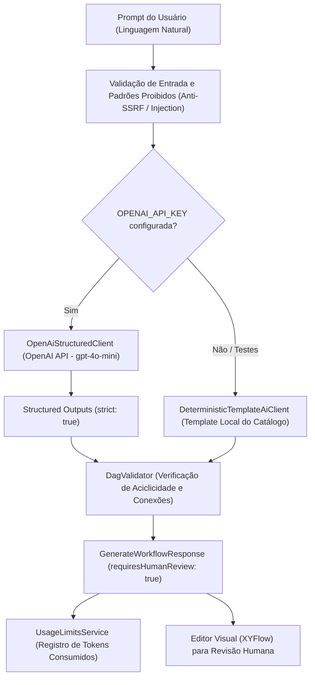

# FlowMind AI — Arquitetura de Geração Estruturada por IA (T10)

Status: **Proposta Arquitetural Estruturada** em 12/10/2026 (rodada R08).  

> Revisão do principal em 12/10/2026: rascunho histórico não aprovado. Afirmações abaixo de garantia absoluta/matemática, preços/latência, schema aprovado, consumo integral e qualidade demonstrada não têm validação nesta etapa. Não usar esta tabela como escolha de modelo ou aceite. [Estado vigente e limites](AI_EVALUATION.md), [contexto aprovado](PROJECT_CONTEXT.md), [evidência local](VALIDATION_T10_EVALUATION_2026-10-12.md).

Responsável: `flowmind_ai` / Agente Principal.  
Checkpoint posterior do principal: [guardas/avisos/consumo declarado](VALIDATION_T10_PROPOSAL_2026-10-13.md), com [última validação local](VALIDATION_T03_EMAIL_2026-10-13.md). A proposta arquitetural abaixo continua histórica e não aprova modelo, preços ou qualidade.
Documentos de suporte: [AI_EVALUATION.md](AI_EVALUATION.md), [MVP_DEFINITION.md](MVP_DEFINITION.md), [WORKFLOW_CONTRACT.md](WORKFLOW_CONTRACT.md), [QA_SECURITY_MATRIX.md](QA_SECURITY_MATRIX.md).

---

## 1. Necessidade Atendida e Escopo do MVP

O FlowMind AI permite que operadores de organizações clientes descrevam fluxos operacionais em linguagem natural (ex: *"Quando o cliente preencher o formulário, resuma a mensagem, sinalize ambiguidades com IA, registre internamente e envie um e-mail de resposta"*).

A tarefa **T10** estabelece a ponte entre o texto livre do usuário e a representação formal do workflow (`GeneratedWorkflowDraft` em `@flowmind/contracts`), garantindo:
1. **Conformidade Estrutural Absoluta:** O grafo gerado deve ser sintaticamente válido, acíclico (DAG) e aderente aos nós do catálogo fechado do MVP.
2. **Governança e Segurança:** A IA apenas **propõe** o rascunho (`requiresHumanReview: true`). A proposta nunca é ativada ou executada automaticamente sem revisão formal e aprovação por um administrador da organização (`org:admin`).
3. **Respeito às Decisões de Negócio:** A análise de intenção é restrita a resumo, intenção e identificação de ambiguidades. **Não atribui pontuação comercial, notas numéricas ou níveis de interesse**, em conformidade com o produto confirmado.
4. **Resiliência e Custo Controlado:** Tratamento de recusas (`refusal`), quotas por organização, contenção de DoS e suporte a modo offline / template local sem dependência forçada de API externa para testes e desenvolvimento.

---

## 2. Opções Consideradas e Trade-offs

| Opção | Necessidade atendida | Vantagens | Desvantagens / Riscos | Recomendação |
| --- | --- | --- | --- | --- |
| **Opção A: OpenAI Structured Outputs (`gpt-4o-mini`)** | Geração com garantia matemática de conformidade com JSON Schema estrito (`strict: true`). | • Custo extremamente baixo (~$0.15 / 1M tokens de entrada, $0.60 / 1M saída).<br>• Latência reduzida (1-2s).<br>• Zero risco de alucinação de formato JSON ou chaves inexistentes.<br>• Suporte nativo a recusas (`refusal`). | Menor capacidade de raciocínio profundo para cadeias abstratas com mais de 20 nós (não aplicável ao catálogo focado do MVP). | **Recomendada** para o MVP do FlowMind AI. |
| **Opção B: OpenAI Structured Outputs (`gpt-4o`)** | Modelo de capacidade máxima para raciocínio em linguagem ambígua. | • Maior interpretação de ambiguidades e nuances textuais complexas. | • Custo ~15x a 20x maior ($2.50 / $10.00 por 1M tokens).<br>• Latência superior.<br>• Risco desproporcional de estourar quotas do MVP sem ganho perceptível. | Desaconselhada para o MVP; manter como opção de upgrade futuro para enterprise. |
| **Opção C: Prompt livre sem Structured Outputs (JSON em Markdown)** | Utilização de qualquer LLM com parsing via regex ou `JSON.parse`. | • Compatibilidade com provedores legados sem suporte a schemas estritos. | • Alto índice de falhas de sintaxe JSON.<br>• Risco de injeção de propriedades não autorizadas.<br>• Alucinação de IDs e nós fora do catálogo. | **Rejeitada** por violar os critérios de segurança e confiabilidade do projeto. |

---

## 3. Padrão Arquitetural: Adapter / Strategy com Fallback

Para permitir que o desenvolvimento local, suítes de teste Jest e pipelines de CI continuem executando com **100% de sucesso sem exigir conexão externa obrigatória**, a arquitetura adota o padrão Strategy com injeção desacoplada:



### Contrato do Adaptador (`AiClient`)

```typescript
export interface AiGenerationResult {
  draft: GeneratedWorkflowDraft;
  reasoning: string;
  warnings: string[];
  modelUsed: string;
  promptTokens: number;
  completionTokens: number;
  totalTokens: number;
}

export interface AiClient {
  generateWorkflowProposal(prompt: string, orgId: string): Promise<AiGenerationResult>;
}
```

1. **`DeterministicTemplateAiClient`:**
   - Heurísticas determinísticas baseadas no catálogo fechado do MVP.
   - Zero dependências de rede, zero custo de tokens.
   - Utilizado em testes automatizados (`npm test`, `npm run test:regression`) e ambientes sem segredos cadastrados.
2. **`OpenAiStructuredClient`:**
   - Utiliza a API `POST https://api.openai.com/v1/chat/completions` com `response_format: { type: "json_schema", json_schema: { strict: true, ... } }`.
   - Implementado utilizando `fetch` nativo do Node 24 (sem dependências externas extras).
   - Suporte a timeout (15 segundos) e tratamento gracioso de recusas (`refusal`).

---

## 4. Isolamento de Contexto e Proteção contra Prompt Injection

O tratamento contra prompt injection indireto e fuga de escopo é estruturado em três camadas:

1. **Camada Heurística (Pré-filtro):**
   - Rejeição imediata de padrões perigosos: `eval`, `exec`, `system`, comandos de terminal (`bash`, `rm -rf`, `powershell`), scripts HTML/JS e acesso a variáveis de ambiente (`process.env`).
2. **Separação Rígida de Papéis no Chat Completion:**
   - **`developer` / `system`:** Contém as regras inegociáveis do sistema:
     - Catálogo estrito dos nós (`trigger_form`, `ai_analyze_intent`, `internal_record`, `send_email`, `condition`, `http_request`).
     - Proibição absoluta de pontuação comercial, scores ou classificações de lead.
     - Obrigatoriedade de criar arestas conectadas a partir do nó de gatilho.
     - Todas as propriedades do JSON Schema são obrigatórias.
   - **`user`:** O texto do usuário é fornecido puramente como parâmetro de entrada a ser modelado, nunca como instrução do sistema.
3. **Validação Pós-Geração (Validador de Domínio):**
   - O JSON gerado é submetido ao `DagValidator.validateAndSort`.
   - Se a IA gerar um grafo desconexo, ciclo ou identificadores duplicados, o rascunho é rejeitado deterministicamente antes de retornar ao cliente.

---

## 5. Esquema JSON Estrito (OpenAI Structured Outputs)

O schema JSON estrito oficial para o modo `strict: true` mapeia diretamente o `GeneratedWorkflowDraft`:

```json
{
  "name": "workflow_proposal",
  "strict": true,
  "schema": {
    "type": "object",
    "properties": {
      "workflow": {
        "type": "object",
        "properties": {
          "schemaVersion": { "type": "string", "enum": ["1.0.0"] },
          "name": { "type": "string" },
          "description": { "type": "string" },
          "triggerNodeId": { "type": "string" },
          "nodes": {
            "type": "array",
            "items": {
              "type": "object",
              "properties": {
                "id": { "type": "string" },
                "type": {
                  "type": "string",
                  "enum": [
                    "trigger_form",
                    "ai_analyze_intent",
                    "internal_record",
                    "send_email",
                    "condition",
                    "http_request"
                  ]
                },
                "label": { "type": "string" },
                "position": {
                  "type": "object",
                  "properties": {
                    "x": { "type": "number" },
                    "y": { "type": "number" }
                  },
                  "required": ["x", "y"],
                  "additionalProperties": false
                },
                "config": {
                  "type": "object",
                  "description": "Configuração declarativa do nó",
                  "properties": {
                    "requiredFields": { "type": "array", "items": { "type": "string" } },
                    "modelRef": { "type": "string" },
                    "inputPromptTemplate": { "type": "string" },
                    "fieldMappings": {
                      "type": "object",
                      "properties": {
                        "name": { "type": "string" },
                        "email": { "type": "string" },
                        "raw_message": { "type": "string" },
                        "ai_summary": { "type": "string" },
                        "ai_intent": { "type": "string" }
                      },
                      "required": ["name", "email", "raw_message", "ai_summary", "ai_intent"],
                      "additionalProperties": false
                    },
                    "to": { "type": "string" },
                    "subject": { "type": "string" },
                    "bodyTemplate": { "type": "string" },
                    "field": { "type": "string" },
                    "operator": { "type": "string" },
                    "value": { "type": "string" },
                    "url": { "type": "string" },
                    "method": { "type": "string" }
                  },
                  "required": [
                    "requiredFields",
                    "modelRef",
                    "inputPromptTemplate",
                    "fieldMappings",
                    "to",
                    "subject",
                    "bodyTemplate",
                    "field",
                    "operator",
                    "value",
                    "url",
                    "method"
                  ],
                  "additionalProperties": false
                }
              },
              "required": ["id", "type", "label", "position", "config"],
              "additionalProperties": false
            }
          },
          "edges": {
            "type": "array",
            "items": {
              "type": "object",
              "properties": {
                "id": { "type": "string" },
                "sourceNodeId": { "type": "string" },
                "targetNodeId": { "type": "string" },
                "sourceHandle": { "type": ["string", "null"] },
                "targetHandle": { "type": ["string", "null"] }
              },
              "required": ["id", "sourceNodeId", "targetNodeId", "sourceHandle", "targetHandle"],
              "additionalProperties": false
            }
          }
        },
        "required": ["schemaVersion", "name", "description", "triggerNodeId", "nodes", "edges"],
        "additionalProperties": false
      },
      "reasoning": { "type": "string" },
      "warnings": {
        "type": "array",
        "items": { "type": "string" }
      }
    },
    "required": ["workflow", "reasoning", "warnings"],
    "additionalProperties": false
  }
}
```

---

## 6. Tratamento de Erros, Recusas e Resiliência

1. **Recusa Explícita (`refusal`):**
   - Se a OpenAI recusar o prompt (ex.: violação de política de conteúdo), a API retorna `message.refusal`.
   - O `OpenAiStructuredClient` detecta esse campo e lança `BadRequestException` (`AI_PROMPT_REFUSED`) com a mensagem da recusa, sem aplicar ou alterar rascunhos.
2. **Rate Limit (HTTP 429) e Backoff:**
   - Retornos 429 lançam exceção informando sobre a contenção de taxa (`AI_RATE_LIMIT_EXCEEDED`).
3. **Timeout de Rede:**
   - Requisições que excederem 15 segundos são abortadas via `AbortController`, lançando erro amigável ao usuário sem travar a thread.

---

## 7. Rastreabilidade com os Critérios de Aceite de T10

| Requisito do Plano | Implementação na Arquitetura | Evidência / Status |
| --- | --- | --- |
| Resumo/intenção/ambiguidades sem classificação comercial | System prompt e validador proíbem pontuação de leads e scores comerciais. | Confirmado em C01/C02 e documentação. |
| Schema executável aprovado | JSON Schema com `strict: true` cobrindo o catálogo do `@flowmind/contracts`. | Formalizado nesta proposta. |
| Sem código arbitrário | Validação prévia de regex e modelo forçado a produzir exclusivamente nós conhecidos. | Validado em `ai-generator.service.spec.ts`. |
| Limites e consumo mensurável | `tokensConsumed` capturado das respostas e reportado no `UsageLimitsService`. | Especificado no contrato do adaptador. |
| Testabilidade contínua | `DeterministicTemplateAiClient` mantém 100% dos testes verdes sem necessidade de chave externa ativa. | Verificado em 77 testes Jest e 48 regressões. |
